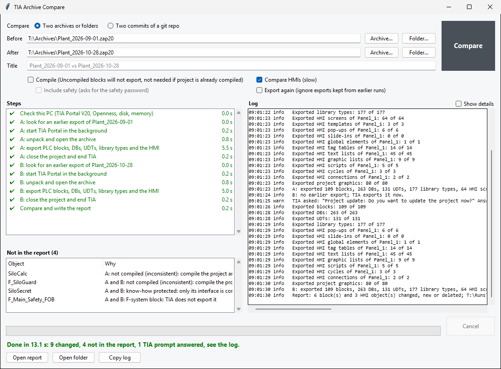
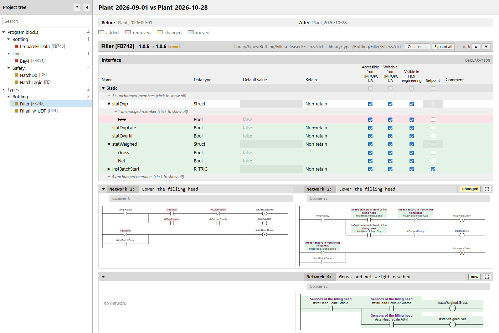

# TIA Archive Compare

Experimental: the tool works, but it may still change.

## What it does

TIA Archive Compare shows what changed between two versions of a TIA Portal project. Select the before and after
versions, then press **Compare**. Each input can be a V20 or V19 archive or project, or a folder of earlier exports. You
can also compare [two commits of a git repo](#two-commits-of-a-git-repo). When the comparison finishes, select **Open
report** to view the results.



The report shows changed, new and deleted PLC blocks, DBs, UDTs, PLC tag tables and project library types using
TIA-style diagrams and tables. For a changed PLC tag table, it lists the tags and user constants that were added,
removed or changed. A new block shows its interface and code as added, and a new PLC tag table shows its tags; a
deleted one shows them as removed. Select **Compare HMIs** to include HMI screens, tag tables and lists. Blocks that only
moved to another folder are listed separately with the **moved** tag; a PLC tag table that only moved carries the same
tag. The **other order** tag on a LAD network means the order of its rungs has changed.

The tool leaves your original archives and projects unchanged. It opens a copy of each archive or project in a background
TIA Portal session and deletes the copy afterwards. Two commits of a git repo open no TIA Portal.

### Two commits of a git repo

Select **Two commits of a git repo**. Choose a repo from the list, which holds the repos in TiaBridge's projects folder
(by default `%USERPROFILE%\TIA-Projects`), or any other repo with **Folder...**. Then choose the before and after commits
by short hash, date and message. The window starts on the repo's last two commits.

This mode needs no TIA Portal and takes a few seconds, but it needs [Git](https://git-scm.com/downloads/win) on the
`PATH`, which the download does not hold. It writes the same report as TiaChangeReports does for those two
commits. The options for archives do not apply: the HMI is compared whenever the commits hold it.

**What it does not see.** The report reads only what was exported and committed. A change in TIA that was never exported is
not in the report, and the report can say "no changes" while the project differs. The report page says so under its title,
and the window in the heading of its **Not in the report** list; its result then reads "no changes in what was
exported and committed". To see what the projects hold, compare two archives, as both are exported for the comparison,
within the [limits](#what-it-does-not) below.

If the folder is not a git repo, the repo has no exports, a commit is not in it or neither commit holds exports, the window
says so and starts nothing. A folder inside a repo is refused too: choose the repo itself.

A commit that holds no exports, such as the repo's first, is compared. Everything in the other commit then reads as new or
deleted, and the log warns of it.

### Example report

[](../docs/user/assets/archive-compare-example.html)

[Download the example report](../docs/user/assets/archive-compare-example.html) and open it in a browser. It uses a fictional project.

## What it does not

The report has the following limits. A result of "no changes" applies only to the content the tool can compare. A file
that is in the exports and that the report does not read, such as a faceplate type version, is named on the report page
under "n other files changed, not read" when it changed, and counts as changed in the result. With more than ten such
files, the line gives a count per file type, such as "319 .libint", and the names open on a click. A file is not named when
it differs only in its export date or object numbers, or when the report tells the difference another way, such as a
library type's version. The report does not show a library type's release comment, and a changed comment is not named
when the report shows a new version beside it, or a version released or put in work. With **Compare HMIs** off, nothing
in `hmi` or `project\graphics` is named. The HMI generator's documents, `hmi\references` and `generated` folders under
`hmi`, are never named, and neither are the lists `graphics.json`, `panel.json` and `handbuilt.json` in `hmi` or in a
device's folder under it.

| Excluded or limited content | Details |
|---|---|
| A change never exported, with two commits of a git repo | The report reads only what was exported and committed. See [Two commits of a git repo](#two-commits-of-a-git-repo). |
| Hardware configuration, external sources | Not compared. The tool does not export the hardware configuration, and TIA Openness V20 has no export of an external source's content. |
| Technology objects, watch and force tables, PLC alarm texts, ProDiag supervisions, project texts, alarm classes, the project's supervision and diagnostics settings, master copies, faceplate types | Not compared. From an archive or project, the tool exports only blocks, DBs, UDTs, PLC tag tables, the project library's types but for faceplate types and, with **Compare HMIs**, the HMI screens, templates, pop-ups, slide-ins, global elements, tag tables, text and graphic lists, scripts, cycles and connections and the project graphics. In an export folder or a commit, a changed file of these is only named, as described above; of a faceplate type, its version files. |
| System blocks | Not compared from an archive or project: the tool does not export them. In an export folder or a commit, they are compared like other blocks. |
| WinCC Unified, faceplate type contents | The tool compares WinCC Comfort and Advanced devices. TIA Openness V20 does not expose the contents of faceplate types. |
| HMI alarms, recipes, logs, user administration | TIA Openness V20 has no export for them. |
| Alarm, trend, recipe and system diagnostics views on a screen | TIA cannot export these objects. They are omitted from the exported screen without a warning. |
| F-system blocks and the F-OB of the safety runtime group | TIA does not export them. Your own compiled F-blocks can be exported like other blocks. |
| Blocks that are not compiled | TIA exports only compiled blocks. Tick **Compile**, or compile the project and archive it again. |
| The code of a know-how protected block | It is protected. Only the block's interface is compared. |
| Global library types | Only the project library is compared. |
| Text in another language | The report shows English, or the first available language for text without an English version. Changes to other translations are not shown; the block receives the note described below. |
| Export fields the report does not read, such as an instruction's version, a block's memory reserve or its header author | Changes to these fields are not displayed; the block or network receives the note described below. |
| The Setpoint setting of a library type's member | The export of a released type version omits this setting, so a change to it cannot be shown: against a version that writes it, the checkbox shows what that version writes and the block receives the note described below. With neither, the checkbox shows what TIA shows for a member without the setting (selected on a UDT or FB instance), which may differ from the setting in the project. For a block in the program, the setting appears in the Interface table. |
| Export-only differences: export time, object numbers, language order and automatically assigned block numbers | These differences do not represent project changes. |

The window's **Not in the report** list names the blocks that were not compiled, are know-how protected or are F-system
blocks. It also lists anything TIA failed to export or the report could not read.

**Differences the report cannot display.** A block may carry the note "The file differs in something this report does
not show"; a network may carry "differs in something this report does not show". This means the exported files differ,
but the report cannot display that difference. Compare the two versions in TIA to investigate it.

The note is not shown for an undisplayed difference when the same network is already marked as changed for another
reason, or when another attribute of the same member has also changed. It is also omitted for differences between XML
and `.s7dcl` exports when the block has other changes.

Other limits:

- **Time.** In measured runs, comparing two archives of a mid-size project (about 100 blocks, 260 DBs, 130 UDTs and
  180 library types) took 5 to 8 minutes. Exporting the PLC tag tables took under a second per archive in a measured
  run with two tables, and the time grows with their number. Repeating a comparison with cached exports takes a few
  seconds. After an update of the tool, the first comparison may export its inputs again instead of using the cache.
  A V19 archive adds about 5.5 minutes for conversion. **Compile** adds the project's compilation time; **Compare HMIs** adds
  20 seconds to a minute per HMI device.
- **Projects open in TIA.** TIA locks open projects, so the comparison fails. Archive the project or close it first.
- **Export folders.** Comparing a before folder without HMI exports against an after archive with **Compare HMIs**
  enabled lists every exported HMI object as new. An export folder's PLC tag tables are compared as well. A folder
  without them against an archive lists the archive's PLC tag tables as new, or as deleted when the folder is the after
  version. A project repo, or any folder TiaBridge's `full_export` wrote, holds more than the tool exports
  from an archive or project: system blocks, technology objects, watch and force tables, PLC alarm texts, ProDiag
  supervisions, project texts, alarm classes, the project's supervision and diagnostics settings, faceplate type
  versions and the list of master copies. Against an archive or project, every system block of such a folder reads as
  deleted, or as new when the folder is the after version, and each of the other files is named under "n other files
  changed, not read". The result is then not "no changes", even when the two projects are alike. A folder with `plc`,
  `hmi` and `library` at its top, and its exports where a project repo holds them, is
  read as a project repo: only `plc`, `hmi`, `project`
  and the library's `types`, `faceplates`, `mastercopies` and `global` count. A block anywhere else in it is not compared:
  the report page names it and the tool lists it as one the report could not read, but for `library\changes`. Any other folder is read whole, but for the
  folders at its top whose name starts with a dot. Other changed files are named on the report page, as under
  **What it does not**, if they lie in the folders listed above. In a folder that has none of `plc`, `hmi` and `library`, any
  changed file is named.
- **Other TIA versions.** An input older than V20 is upgraded in the copy. Only V19 has been run. An older one, such as
  `.zap18`, is not refused: it goes on to the upgrade, and the step fails if TIA cannot do it. V21 and later are refused.
- **Several projects in a folder.** If a folder contains several `.ap20` files, select the project file instead of the
  folder.
- **Protected projects.** A project-user login is tested: the window asks once per archive. A UMC server login is not
  tested. An agent cannot give a login: its run stops there, so run that comparison in the window.
- **Path length.** TIA refuses projects whose file paths are too long for Windows (about 260 characters) or for TIA, which
  allows 143. The step fails with a path-length error, and the log identifies the path.

## How to use

First, **install TIA Openness.** Select the **TIA Openness** option in the TIA Portal V20 installer. Ask IT to add your
Windows account to the **Siemens TIA Openness** group, then sign out of Windows and sign back in. Then get the tool from
the download or from a clone of this repository.

### From the download

1. **Download.** On the **Releases** page of this repository on GitHub, download `TIA-Archive-Compare-<version>.zip`
   from the latest release.
2. **Unblock it.** Right-click the zip, select **Properties**, tick **Unblock** and select **OK**. Windows marks what
   comes from the internet, and unpacking passes the mark on to every file: the tool's PowerShell scripts may then be
   refused where your company's policy allows only local or signed ones.
3. **Unpack** it: right-click it, select **Extract All** and choose a folder of your own, such as `C:\Tools`. The
   tool is then in its folder `TIA-Archive-Compare-<version>` there.
4. **Start** with a double-click on `TIA Archive Compare.exe` in that folder. The program is not signed, so if you did
   not unblock the zip, Windows SmartScreen shows "Windows protected your PC" the first time: select **More info**, then
   **Run anyway**. For a shortcut on the Desktop, right-click the program and select **Send to** > **Desktop (create
   shortcut)**; on Windows 11, select **Show more options** first.

The folder holds everything the tool needs, Python included: nothing to install, and no console window opens. The
tool keeps its settings, its cache of exports and its work copies in `%LOCALAPPDATA%\TIA Compare`, and its reports in
`Documents\TIA Compare`. Its `TiaBridge\settings.json` is in the unpacked folder (see [Requirements](#requirements)).
For a new version, unpack its zip into a new folder and copy that file over, if you made one; then delete the old
folder. To remove the tool, delete its folder, and `%LOCALAPPDATA%\TIA Compare` for the cache.

### From a clone

1. **Set up Python.** Install [uv](https://docs.astral.sh/uv/), clone this repository and run `uv sync` from the
   repository folder. This creates `.venv` and installs the required Python packages.
2. **Make the shortcut, once.** From the repository folder:

   ```
   .venv\Scripts\python.exe -X utf8 -m TiaArchiveCompare.window.shortcut
   ```

   This puts **TIA Archive Compare** on your Desktop; add `--folder <folder>` to put it elsewhere. Double-click it to start
   the tool. No console window opens. You can move or copy the shortcut anywhere. It holds the paths of this clone, so make
   it again if you move the clone. From a terminal, the tool also starts with
   `.venv\Scripts\python.exe -X utf8 -m TiaArchiveCompare.window`, from the repository folder.

With a clone, an agent can run a comparison too. Ask it to compare two archives or projects; it gives you the report page.

To try the tool without TIA, use the [samples](runner/samples/README.md).

## Requirements

- Windows with **TIA Portal V20** and the **TIA Openness** option installed. Your Windows account must belong to the
  **Siemens TIA Openness** group. The tool checks these requirements before starting TIA and tells you what is missing.
- TIA Portal in `C:\Program Files\Siemens\Automation\Portal V20`. If it is in another folder, name that folder as
  `tiaRoot` in `TiaBridge\settings.json`, creating the file if needed: `{ "tiaRoot": "D:\\Siemens\\Portal V20" }`, with each
  backslash doubled. If TIA Portal is not in the folder the tool looks in, the comparison stops with a message that
  names the folder. If `TiaBridge\settings.json` cannot be read, it stops with a message that names the file. In both
  cases, earlier exports in the cache can still be used.
- **Two commits of a git repo** need only **Git** on the `PATH`, and from a clone the Python below, not the requirements
  for TIA Portal.
- From a clone: the repository's `.venv`, from `uv sync`, with **Python 3.12 or later** and **tkinter**, which the usual
  Python installers include. The download holds its own Python. The tool does not use Python from `PATH`.
- About **2 GB of free disk space** and **4 GB of available memory**. One background TIA session uses 2 to 4 GB of
  memory. A PC with 16 GB may run short if you also have TIA Portal open.
